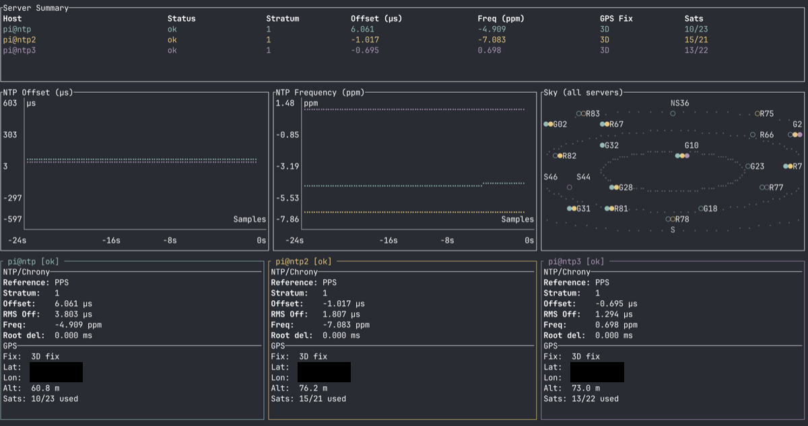

# stratum

Real-time NTP/GPS timing monitor for chrony+gpsd clusters

stratum is a read-only Rust TUI application that monitors 1–6 LAN NTP/GPS
servers simultaneously over SSH. It displays color-coded offset and frequency
graphs, per-server detail panels, a summary table across all servers, and a
polar satellite sky plot — with no agent or daemon installed on the monitored
servers.

> **Note on first connection:** stratum uses TOFU (Trust On First Use) for SSH
> host-key verification. On first connection to a new server the host key is
> accepted and stored in your `~/.ssh/known_hosts`. This carries the usual TOFU
> MITM risk; verify fingerprints out-of-band if your threat model requires it.

## Features

- Monitors 1–6 servers simultaneously.
- Timing console with segmented server clocks, offset needles and light-distance equivalents.
- Combined color-coded graphs (one line per server per metric) with axis scales.
- Per-server detail panels.
- Summary table across all servers.
- Polar satellite sky plot.
- SSH-based collection — no agent installed on the monitored servers.
- Supports chrony and `ntpq`.
- gpsd satellite data collected via SSH port-forward.
- Read-only — never configures or mutates devices/servers.
- Runs on Linux x86_64 and macOS arm64.

## Screenshots



## Prerequisites

- Rust stable toolchain.
- SSH access to target servers running chrony/`ntpq` plus gpsd.
- Servers reachable via the user's `~/.ssh/` config (keys, `known_hosts`).

## Installation

```sh
cargo build --release
```

Binary: `target/release/trmnlapp`

## Usage

```
trmnlapp [OPTIONS] <USER@HOST>...
```

Pass 1–6 servers as `user@host` (or bare `host`, which uses `$USER` and your
SSH config).

**Single server:**

```sh
trmnlapp pi@ntp1
```

**Three servers:**

```sh
trmnlapp pi@ntp1 pi@ntp2 pi@ntp3
```

## Timing console

The app starts in Timing view. **Tab** switches between Timing and the original
Dashboard; **q** or **Ctrl-C** quits. Cards use the existing server colors, up to
three columns. Taller cards show segmented digits and a seconds sweep; compact
cards show ordinary digits. If all servers cannot fit, a resize hint gives the
required terminal geometry. Six hosts fit in 80x24 (compact) or 120x40.

**Server UTC ~** estimates the host's system clock using an optional read-only
SSH `date +%s.%N` command. GNU-compatible output must contain unsigned epoch
seconds and exactly nine fractional digits. Availability on your servers is
unverified until a successful runtime response; unsupported output or a query
exceeding two seconds displays unavailable. Unsupported `date` does not disable
NTP or GPS collection.

The sample is associated with the local request midpoint and advanced using
monotonic elapsed time. Only whole-second UTC digits are displayed. Capture RTT
and sample age are shown: timing ambiguity is approximately half RTT under a
stationary clock, plus unknown remote-clock error, resolution and drift. This
is not an accuracy bound, a precision NTP query, or chronyd's virtual NTP clock;
printing nanoseconds does not establish nanosecond accuracy. Remote clock steps
may visibly jump; the view does not smooth them away.

**Last offset** comes only from chrony tracking. Positive/right means the local
clock was ahead of its sources at that update. Every needle uses the same
**±1 us** range, with zero at the midpoint. Over-range values show `<` or `>`
and retain the numeric offset. `ntpq` fallback shows Last offset n/a here and
continues to populate the original dashboard. Leap status is displayed and
unknown/unsynchronised states do not imply clock lock.

**Light equiv** is the magnitude of Last offset multiplied by
299,792,458 metres/second, displayed in metres or kilometres. For example,
a synthetic 1 us offset corresponds to 299.792458 m. This numerical equivalent
is not measured range, position error, signal travel time or satellite relativity.

Clock and NTP receipt ages are independent. Each remains fresh for at most
five seconds while the server status is OK. Older or disconnected samples show
STALE/OFFLINE and placeholders; the sweep and needle stop displaying live data.
GPS updates do not refresh these ages. Clock capture failure hides the clock
without hiding fresh chrony metrics. NTP age measures collection receipt, not
the age of chrony's underlying reference measurement.

## License

GPL-3.0-or-later. See [LICENSE](LICENSE).
